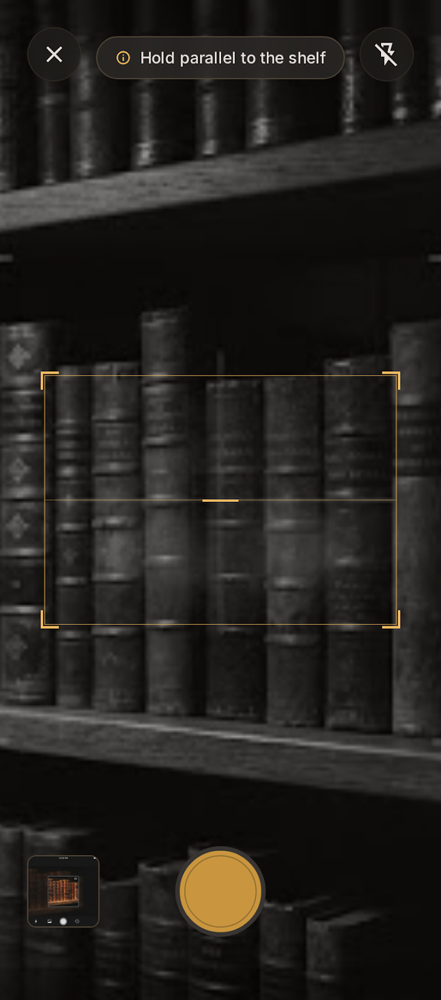
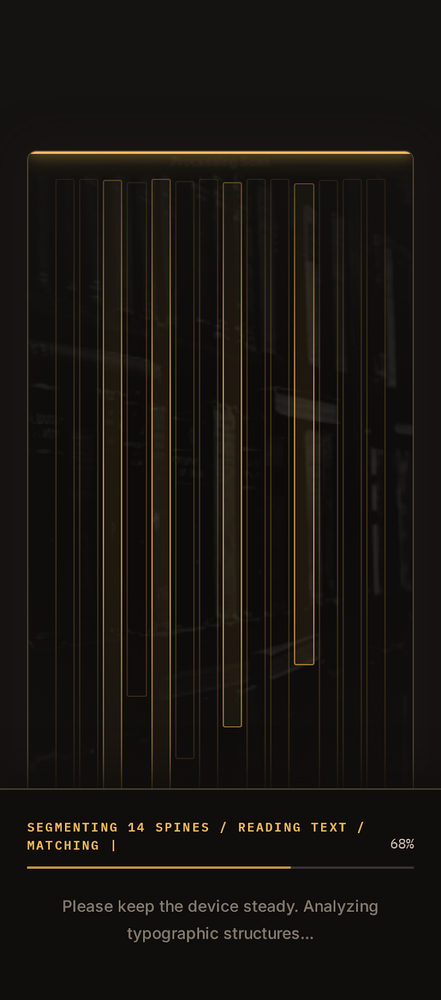
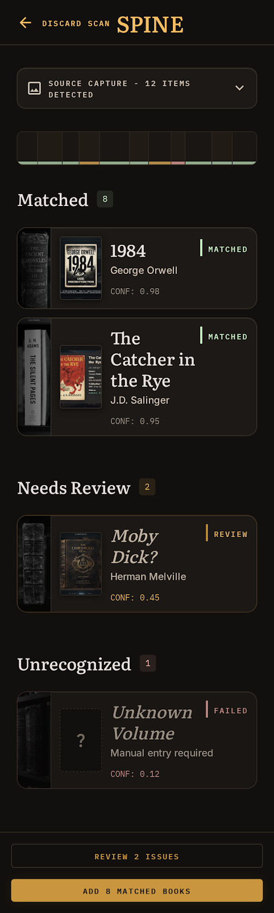
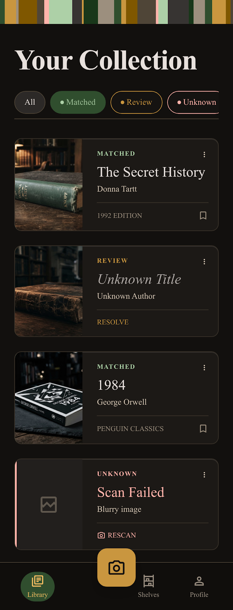
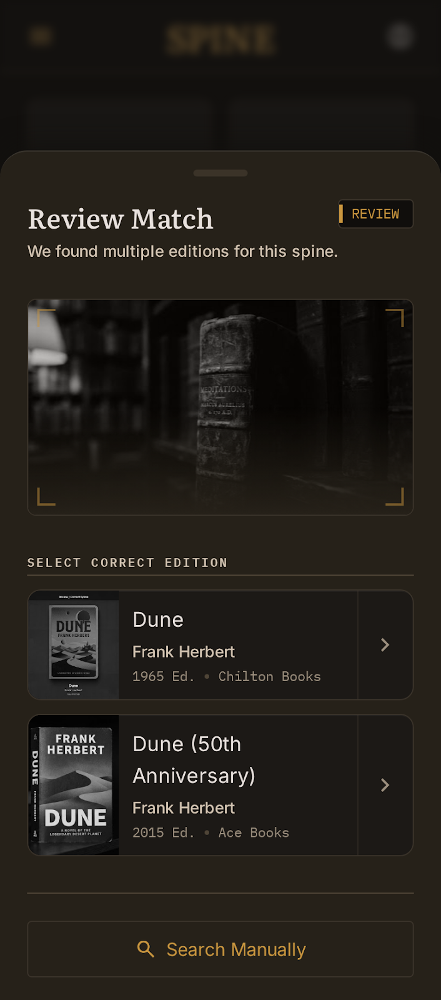
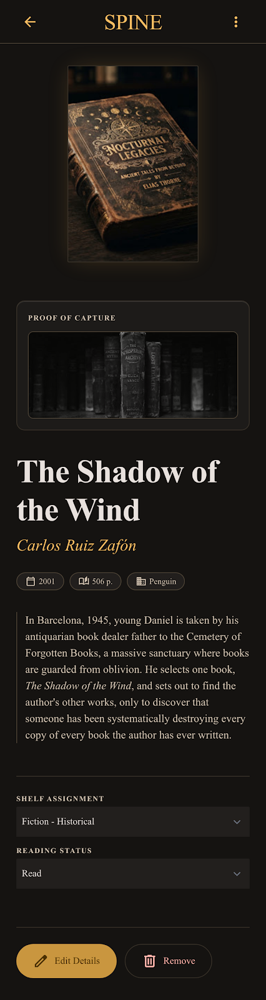

<div align="center">



<br />


<br /><br />

**Rafının fotoğrafını çek; kitapların 10 saniye içinde dijital koleksiyonuna eklensin.**
<br />
<sub>Barkod okutmadan, tek tek yazmadan. Fotoğraflar cihazında kalır, buluta yalnızca okunan metin gider.</sub>

<br /><br />

[**Nasıl Çalışır?**](#-nasıl-çalışır) • [**Tasarım Sistemi**](#-tasarım-sistemi--nocturnal-archivist) • [**Ekran Mockup'ları**](#-ekranlar) • [**Mimari**](#%EF%B8%8F-teknik-mimari) • [**Geliştirme**](#%EF%B8%8F-geliştirme-ve-test)

</div>


## 🇹🇷 Kısaca Rafça

**Rafça**, fiziksel kitaplığınızı tek bir raf fotoğrafından tanıyan ve arşivleyen yerel-önce (local-first) bir mobil uygulamadır.

Geleneksel barkod tarayıcılarının aksine, rafta yan yana dizili onlarca kitabın sırtlarını eşzamanlı olarak tespit eder, perspektif bozulmalarını düzeltir, 4 yönlü OCR ile sırt yazılarını okur ve Open Library kataloğu üzerinden trigram + FTS eşleştirmesi yaparak koleksiyonunuza kaydeder.

### 🌟 Öne Çıkan Nitelikler

- **Gerçek Zamanlı Su Terazisi & Titreşim Engelleme:** Kamera deklanşörü, telefon rafa tam paralel tutulmadan (±7° tolerans) ve ivme sensörü stabil olmadan deklanşörü serbest bırakmaz.
- **Saf Dart Sırt Kümeleme (`packages/spine_clustering`):** ML Kit çıktısı metin bloklarını medyan sırt genişliği ve Otsu eşikleme ile kitap sınırlarına böler.
- **3 Kademeli Güven Sistemi:**
  - `MATCHED` (Yeşil): Kesin eşleşme, doğrudan kütüphaneye eklenir.
  - `REVIEW` (Pirinç Altın): Alternatif baskılar veya yazar çakışması için kullanıcı seçimi.
  - `UNKNOWN` (Kırmızı): Tanınamayan sırtlar, manuel arama veya tek-tık VLM desteği.
- **İmza Bileşen — `ShelfStrip`:** Kitap sırtlarının baskın renklerini piksel oranlarına göre yatay bir renk şeridine dönüştürür.
- **Kayıpsız Gizlilik:** Fotoğraflar asla buluta yüklenmez; yerel diskte kalır. Sunucuya yalnızca ham OCR metni gönderilir.


## ⚡ Nasıl Çalışır?

<div align="center">
  
</div>

1. **Yakalama:** Yüksek çözünürlüklü deklanşör, sensör doğrulaması ile en net kareyi yakalar.
2. **Kadraj & Warp:** Kullanıcı raf alanını 4 köşe sürükleyerek seçer; bilinear ters eşleme ile perspektif kusursuz düzeltilir.
3. **4-Açılı OCR:** ML Kit motoru 0°, 90°, 180° ve 270° açılarında çalışır; dikey ve ters akan sırt metinleri kaçırılmaz.
4. **Bulanık Eşleme:** Go tabanlı `matchd` servisi, PostgreSQL `pg_trgm` + `tsvector` ile başlık ve yazarları eşler.
5. **Yerel Arşiv:** Drift SQLite veritabanına kaydedilir; internet olmasa dahi kütüphane anında açılır.


## 🎨 Tasarım Sistemi — *Nocturnal Archivist*

Rafça, tüketici uygulamalarının yapay ve parlak arayüzleri yerine, **gece yarısı sessiz bir kütüphanenin** dinginliğini yansıtan özel bir estetiğe sahiptir:

- **Zemin:** `#12100E` (Obsidian Ink) — derin, dingin siyah.
- **Vurgu:** `#C9963F` & `#F5BD62` — deri cilt üzerindeki varak baskıyı andıran sıcak pirinç altın.
- **Tipografi:** Başlıklarda edebi **Literata** (serif), arayüzde fonksiyonel **Inter**, ISBN ve güven loglarında ise **IBM Plex Mono**.
- **Işık ve Katman:** Agresif gölgeler yerine 1px hairline çerçeveler (`#3A332A`) ve %10 iç üst parlaklık.


## 📱 Ekranlar

<div align="center">
  <table>
    <tr>
      <td align="center" width="33%">
        <b>Canlı Tarama &amp; Tesviye</b><br /><br />
        
      </td>
      <td align="center" width="33%">
        <b>İşleniyor &amp; Arşiv Logu</b><br /><br />
        
      </td>
      <td align="center" width="33%">
        <b>Tarama Sonuçları</b><br /><br />
        
      </td>
    </tr>
    <tr>
      <td align="center" width="33%">
        <b>Dijital Kütüphane</b><br /><br />
        
      </td>
      <td align="center" width="33%">
        <b>Sırt Doğrulama Sheet'i</b><br /><br />
        
      </td>
      <td align="center" width="33%">
        <b>Kitap Detay Sayfası</b><br /><br />
        
      </td>
    </tr>
  </table>
</div>


## 🏗️ Teknik Mimari

```
Rafça Monorepo
├── /app                  # Flutter 3.47+ istemci (iOS & Android)
│   ├── lib/core          # Router, tema, Drift SQLite yerel DB
│   ├── lib/design        # Nocturnal Archivist bileşenleri, tokenlar, ShelfStrip
│   └── lib/features      # Capture (Faz 6), Review, Library
├── /packages
│   └── spine_clustering  # Saf Dart sırt segmentasyon algoritması
├── /services
│   ├── index             # Open Library üç geçişli indeksleyici (Go)
│   └── match             # Trigram + FTS eşleştirme servisi (Go matchd)
├── /supabase             # PostgreSQL şeması, RLS kuralları ve pgTAP testleri
└── /spike                # Doğruluk ölçüm seti ve Apple Vision CLI probu
```


## 🛠️ Geliştirme ve Test

```bash
# Bağımlılıkları yükle
cd app && flutter pub get

# Statik analiz (sıfır uyarı / 0 issues)
flutter analyze

# Mobil birim ve widget testleri (68/68 yeşil)
flutter test

# Kümeleme paketi ve spike değerlendirme testleri
make test
make analyze

# Faz 0 Doğruluk değerlendirmesi
make eval
```


<div align="center">
<sub>Kutluhan — <a href="https://github.com/kutluhangil">@kutluhangil</a></sub>
</div>
