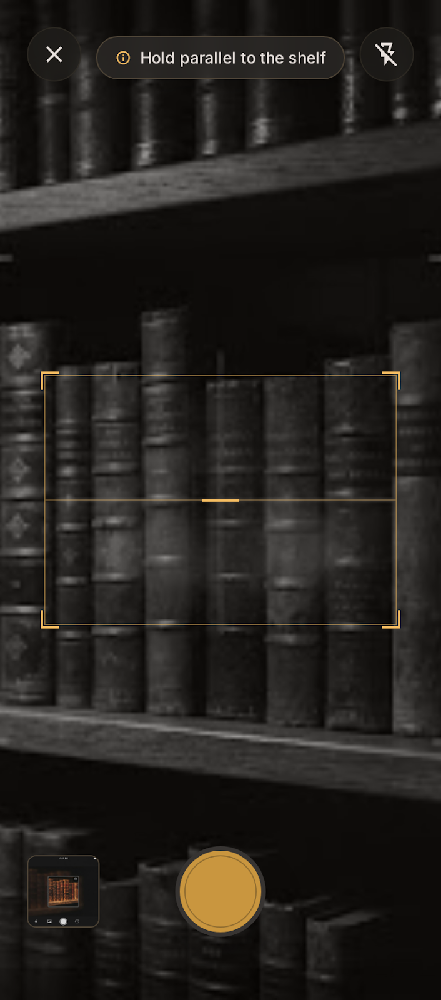
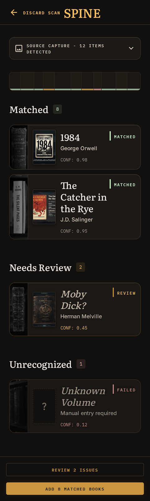
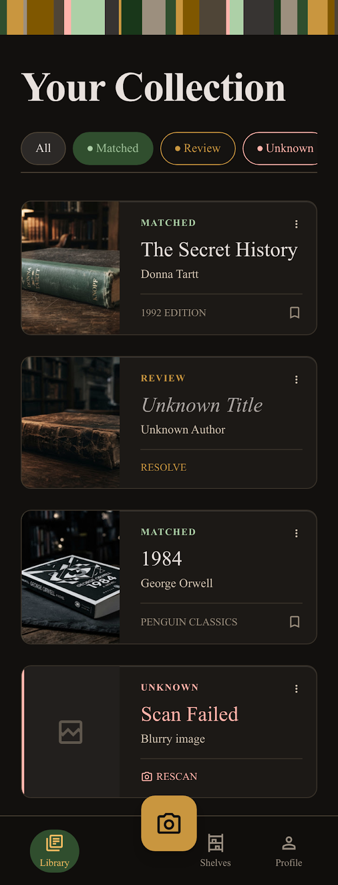
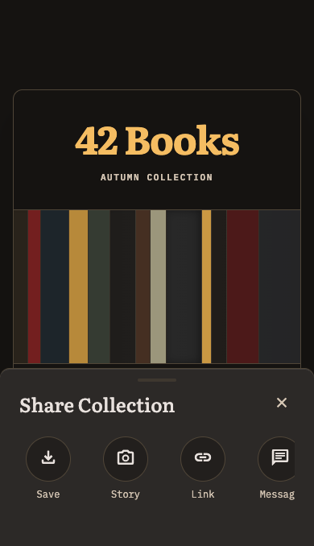

<div align="center">



<p>
  
  
  
  
</p>

<p><em>Photograph your shelf and the books land in your digital collection within seconds.<br>
No barcodes, no typing. Photos stay on your phone; only the recognised text goes to the server.</em></p>



</div>


## What it is

Rafça is a local-first mobile app that recognises a physical bookshelf from one photo. Instead of scanning barcodes one by one, it finds dozens of spines side by side, corrects perspective, reads the spine text from four directions and matches each book against the Open Library catalogue.


## How it works

| Step | |
|---|---|
| **1 · Capture** | A spirit level and shake guard: the shutter only releases when the phone is parallel to the shelf (±7°) and steady. |
| **2 · Frame and warp** | Drag four corners around the shelf; bilinear inverse mapping straightens the perspective. |
| **3 · Four-angle OCR** | ML Kit runs at 0°, 90°, 180° and 270°, so vertical and upside-down spine text is never missed. |
| **4 · Spine clustering** | A pure-Dart package splits text blocks into books by median spine width and Otsu thresholding. |
| **5 · Fuzzy match** | The Go `matchd` service matches titles and authors with PostgreSQL `pg_trgm` and `tsvector`. |
| **6 · Local archive** | Results are stored in a Drift SQLite database; the library opens instantly, even offline. |

Every match lands in one of three states: **MATCHED** (green, added directly), **REVIEW** (brass, pick the right edition or author) or **UNKNOWN** (red, search manually or ask a vision model with one tap).

<table>
  <tr>
    <td width="25%"></td>
    <td width="25%"></td>
    <td width="25%"></td>
    <td width="25%"></td>
  </tr>
  <tr>
    <td align="center"><code>capture</code></td>
    <td align="center"><code>results</code></td>
    <td align="center"><code>library</code></td>
    <td align="center"><code>shelf card</code></td>
  </tr>
</table>


## Design: Nocturnal Archivist

The interface borrows the calm of a quiet library at midnight: an obsidian-ink base (`#12100E`), warm brass accents like gold tooling on leather (`#C9963F`, `#F5BD62`), Literata for titles, Inter for the interface and IBM Plex Mono for ISBNs. Its signature component, `ShelfStrip`, turns the dominant colours of the spines into a horizontal colour band.


## Türkçe özet

**Rafça**, kitaplığının tek bir fotoğrafından kitapları tanıyıp dijital koleksiyonuna ekleyen, yerel öncelikli bir mobil uygulama. Barkod okutmadan, tek tek yazmadan: raftaki sırtları bulup perspektifi düzeltiyor, sırt yazılarını dört yönden OCR ile okuyor ve Open Library kataloğuyla eşleştiriyor. Fotoğraflar telefondan çıkmıyor, sunucuya yalnızca okunan metin gidiyor. Kütüphane internet olmadan da açılıyor.


## Development

```sh
cd app && flutter pub get
flutter analyze
flutter test
make test        # clustering package and spike evaluation
make eval        # phase-0 accuracy evaluation
```

```
app/                   Flutter client (iOS + Android): core, design, features
packages/              spine_clustering, pure Dart
services/index         Open Library indexer (Go)
services/match         trigram + full-text matching service (Go)
supabase/              schema, RLS and pgTAP tests
spike/                 accuracy set and an Apple Vision CLI probe
```

<div align="center">
<br>
<a href="https://github.com/kutluhangil"></a>
<sub>For readers whose shelves are bigger than their spreadsheets.</sub>
</div>
